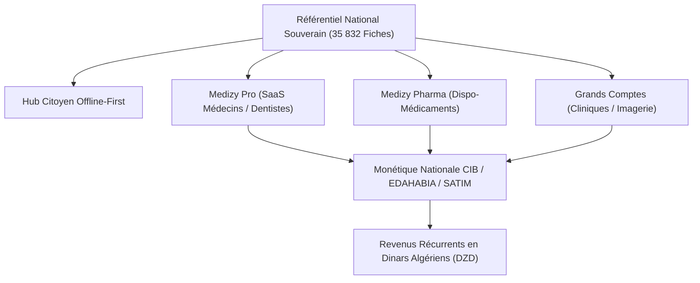

# Spécifications de l'Écosystème Rentable Santé DZ / Medizy v1.0.17

**Plateforme Nationale d'E-Santé & Écosystème Médical Souverain**  
**Version :** 1.0.17 (Enterprise Suite)  
**Date :** 19 Octobre 2026  
**Audience :** Direction Technique, Ministère de la Santé (MSPRH), Partenaires Professionnels (Ordres des Médecins & Pharmaciens)

---

## 1. Vision Stratégique & Modèle Économique (Haute Rentabilité)

Medizy v1.0.17 transforme le référentiel sanitaire exhaustif de l'Algérie (**35 832 structures certifiées sur 58 wilayas**) en une plateforme technologique souveraine à forte rentabilité récurrente, articulée autour de 4 piliers majeurs :

### 1.1 Grille Tarifaire B2B & Projections Financières

| Module SaaS | Cible Professionnelle | Tarif Unitaire / Mois | Potentiel Cible | Revenu Annuel Potentiel (ARR) |
| :--- | :--- | :---: | :---: | :---: |
| **Medizy Pro** | Médecins spécialistes, généralistes, dentistes | **3 500 DZD** | 16 348 praticiens privés | **686 616 000 DZD (~5,1 M$)** |
| **Medizy Pharma** | Pharmacies d'officine privées | **2 500 DZD** | 6 229 pharmacies | **186 870 000 DZD (~1,4 M$)** |
| **Medizy Cliniques** | Cliniques médico-chirurgicales & imagerie | **18 000 DZD** | 412 établissements | **88 992 000 DZD (~660 k$)** |
| **Total Écosystème** | **Secteur Médical Privé National** | — | **22 989 professionnels** | **962 478 000 DZD (~7,2 M$)** |

---

## 2. Architecture Technique des Nouveaux Modules

### 2.1 File d'Attente Virtuelle & Ticket Intelligent (`lib/features/pro/`)
- **Problématique résolue :** Élimine l'encombrement des salles d'attente, les conflits d'accueil et les files d'attente à l'aube.
- **Fonctionnement :**
  - Prise de ticket virtuel depuis l'application avec hachage cryptographique du numéro de téléphone (Loi 18-07).
  - Triage dynamique avec priorité absolue aux urgences vitales et pédiatriques.
  - Estimation en temps réel de l'heure de passage basée sur la durée moyenne de consultation (15 min standard).
  - Gestion des statuts : `waiting`, `called`, `inConsultation`, `completed`, `noShow`, `cancelled`.

### 2.2 Réseau "Dispo-Médicaments" (`lib/features/pharma/`)
- **Problématique résolue :** Fin de la pénurie d'information sur la disponibilité des médicaments introuvables.
- **Fonctionnement :**
  - Catalogue officiel des Dénominations Communes Internationales (DCI) algériennes et mapping des marques commerciales (ex: *Augmentin* -> *Amoxicilline + Acide Clavulanique*).
  - Diffusion push discrète aux pharmacies inscrites dans un rayon configurable de 5 à 15 km.
  - Console de comptoir en 1 clic pour l'officine : `[DISPONIBLE]`, `[ÉQUIVALENT DISPONIBLE]`, `[NON DISPONIBLE]`.
  - Réservation bloquée pendant 2 heures sans révélation des données nominatives du patient.

### 2.3 Passerelle Monétique SATIM / CIB / EDAHABIA & BaridiMob (`lib/core/finance/`)
- **Cartes bancaires supportées :**
  - Carte EDAHABIA d'Algérie Poste (BINs `603577`, `2404`, `628051`).
  - Carte CIB Interbancaire SATIM (BINs `5354`, `5211`, `4000`, `5130`).
- **Protocole de transaction :**
  - Algorithme de contrôle d'intégrité Luhn.
  - Déclenchement de challenge 3-D Secure OTP.
  - Capture et délivrance du code d'approbation SATIM officiel (`SAT-APV-xxxxxx`).
  - Émission de factures et quittances fiscales en DZD avec NIF, NIS et Registre de Commerce.
  - Alternative BaridiMob : Validation du Relevé d'Identité Postale (RIP 20 chiffres) avec formule de clé modulo 97.

### 2.4 Moteur de Triage Symptomatique IA Local (`lib/core/ai/`)
- **Cadre éthique :** Conforme aux directives du Conseil de l'Ordre et de la Loi 18-07 (zéro diagnostic formel, orientation pure).
- **Langues traitées hors ligne :** Français médical & Darija algérienne (arabe standard, script arabe et translittéré).
- **Niveaux de gravité :**
  - **VERT :** Consultation de routine / programmée.
  - **ORANGE :** Consultation recommandée sous 24h.
  - **ROUGE :** Urgence vitale immédiate avec déclencheur direct SAMU (15) / Protection Civile (14).
